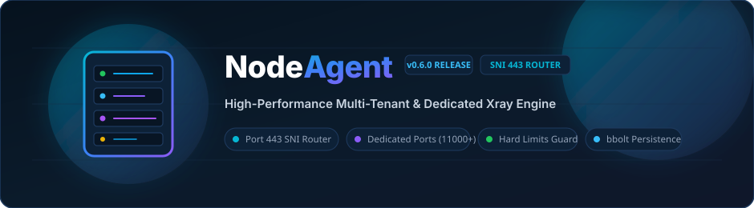
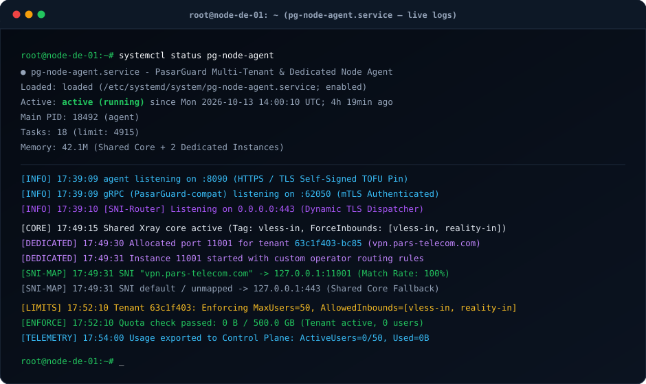
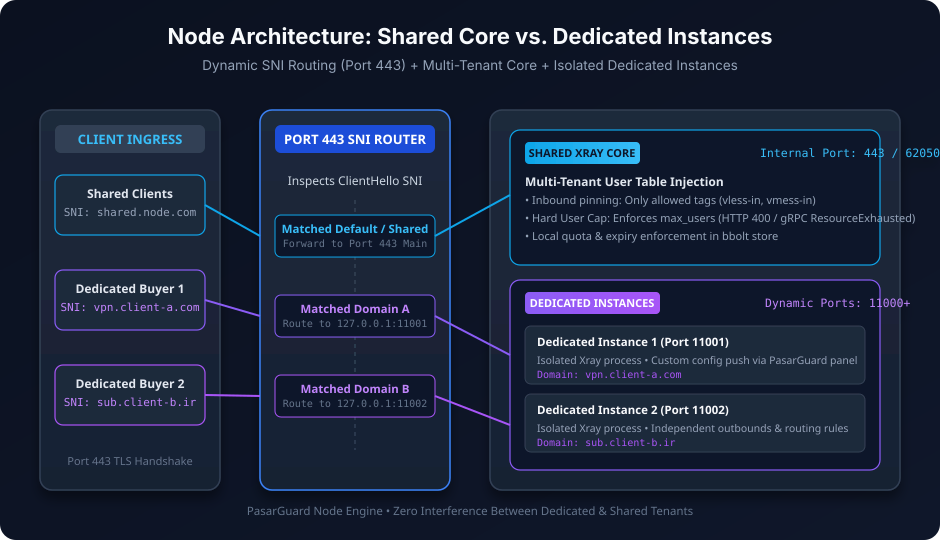
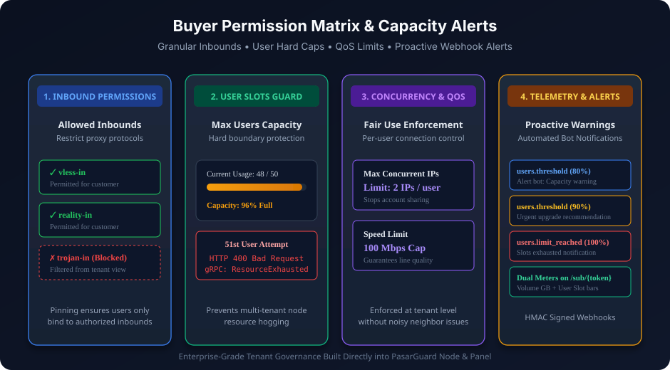

<div align="center">



# NodeAgent — PasarGuard Multi-Tenant & Dedicated Node Engine

[](https://github.com/loopy-iri/NodeAgent/releases)
[](https://go.dev/)
[](https://github.com/loopy-iri/NodeAgent)
[](docs/images/architecture.svg)
[-8b5cf6?style=for-the-badge)](docs/images/architecture.svg)
[](docs/images/preview.svg)

<p align="center">
  <b>موتور قدرتمند چند-مستأجری و هسته اختصاصی نود بر پایه فورک PasarGuard</b><br/>
  <i>مسیریابی هوشمند SNI روی پورت 443 • ایزولاسیون کامل هسته‌های اختصاصی • اعمال سقف سخت‌افزاری کاربران</i>
</p>

[گزارش باگ](https://github.com/loopy-iri/NodeAgent/issues) · [مستندات کامل ویکی](docs/wiki/Home.md) · [مخزن پنل کنترل (NodePanel)](https://github.com/loopy-iri/NodePanel)

</div>

---

## 🖥️ وضعیت لایو و ترمینال سرویس نود (Live Engine Status Preview)



---

## 🏗️ معماری هسته اشتراکی و هسته‌های اختصاصی (Architecture Overview)



---

## 🛡️ ماتریس دسترسی و کنترل ظرفیت خریداران (Buyer Permissions & Governance)



---

## ✨ ویژگی‌های کلیدی
- **تفکیک کامل هسته اشتراکی و اختصاصی:**
  - **Shared Core:** کاربران چندین خریدار روی یک هسته سبک Xray با نیم‌اسپیسینگ امن ایمیل و مشخصات اعمال می‌شوند.
  - **Dedicated Instances:** اجرای اینستنس‌های مستقل Xray روی پورت‌های پویا (`11000+`). خریدار اختصاصی آزادی کامل در تعریف روتینگ و اوت‌باندهای خود دارد.
  - **Port 443 SNI Dispatcher:** تمام ترافیک کلاینت‌ها روی پورت استاندارد ۴۴۳ دریافت شده و بر اساس دامنه SNI مستقیماً به پروسس اختصاصی خریدار هدایت می‌شود (ترافیک پیش‌فرض به هسته اشتراکی می‌رود).
- **اعمال سقف سخت کاربران (`max_users`):** بررسی لحظه‌ای تعداد کاربران فعال مستاجر و رد درخواست در صورت تکمیل ظرفیت با خطای `HTTP 400 Bad Request` و gRPC `codes.ResourceExhausted`.
- **فیلتر سخت‌گیرانه اینباندها (`allowed_inbounds`):** پین کردن اجباری کاربران خریدار فقط روی تگ‌های اینباند مجاز.
- **تله‌متری و نظارت زنده:** ارائه آمار لحظه‌ای تعداد کاربران فعال (`active_users`) و حجم مصرفی به پنل کنترل.
- **پایداری داده‌ها با bbolt:** ذخیره‌سازی محلی تمام سهمیه‌ها، سقف‌ها و دامنه‌ها جهت حفظ پایداری پس از ری‌استارت.
- **سازگاری کامل gRPC با PasarGuard (پورت ۶۲۰۵۰):** خریدار نود شما را مثل یک نود استاندارد به پنل شخصی‌اش وصل می‌کند.

---

## 🚀 راهنمای نصب و راه‌اندازی سریع

### نصب خودکار با اسکریپت (سیستم‌های مبتنی بر لینوکس / systemd)
```bash
# دانلود و نصب باینری آماده بدون نیاز به کامپایل:
sudo bash -c "$(curl -sL https://raw.githubusercontent.com/loopy-iri/NodeAgent/main/scripts/pg-node.sh)" @ install
```

### اجرای محلی جهت توسعه و تست
```bash
# تنظیم متغیرهای محیطی
$env:API_KEY = "11111111-2222-3333-4444-555555555555"
$env:PG_AGENT_MASTER_KEY = "node-master-key-secret-9876543210"
$env:PG_AGENT_HTTP_ADDR = ":8090"
$env:PG_AGENT_GRPC_ADDR = ":62050"
$env:SSL_CERT_FILE = "certs/ssl_cert.pem"
$env:SSL_KEY_FILE = "certs/ssl_key.pem"
$env:GENERATED_CONFIG_PATH = "generated/"
$env:PG_AGENT_TENANT_DB = "tenants.bolt"

# اجرا
./agent.exe
```

---

## ⚙️ متغیرهای محیطی (Environment Variables)

| متغیر | پیش‌فرض | الزامی | شرح |
|---|---|:---:|---|
| `PG_AGENT_HTTP_ADDR` | `:8090` | خیر | آدرس و پورت API کنترلی نود (HTTPS) |
| `PG_AGENT_MASTER_KEY` | — | **بله** | کلید مستر جهت ارتباط امن پنل کنترل با نود |
| `API_KEY` | — | **بله** | شناسه نود (یک UUID معتبر و غیرنیل) |
| `PG_AGENT_GRPC_ADDR` | `:62050` | خیر | آدرس و پورت سازگار gRPC PasarGuard |
| `PG_AGENT_CORE_KEY` | تولید خودکار | خیر | کلید مدیریت کانفیگ هسته از پنل اپراتور |
| `PG_AGENT_FORCE_INBOUNDS` | `vless-in` | خیر | تگ‌های پیش‌فرض اینباندها (کاما-جدا) |
| `PG_AGENT_TENANT_DB` | `tenants.bolt` | خیر | مسیر فایل دیتابیس لوکال مستأجرین |
| `SSL_CERT_FILE` / `SSL_KEY_FILE` | `/var/lib/pg-node/...` | خیر | مسیر گواهی و کلید TLS نود (در صورت نبود خودکار تولید می‌شود) |

---

## 📂 ساختار پروژه
```
cmd/agent/            نقطه ورود و اجرای باینری نود
tenant/               مدیریت مستأجرین، کلیدها، سقف کاربران و دیتابیس bbolt
shared/               مدیریت هسته اشتراکی + instance_manager (هسته‌های اختصاصی و SNI router)
controller/agent/     اندپوینت‌های HTTP دو سطحی (Master و Tenant) + لوپ انفرسمنت
controller/grpccompat/ سرور gRPC سازگار با پنل PasarGuard (هسته اختصاصی و اشتراکی)
backend/, common/     ماژول‌های پایه و پروتکل‌های هسته Xray
```

---

<div align="center">
  <sub>طراحی شده برای پایداری و ایزولاسیون کامل در فروش دسترسی نودها</sub>
</div>
